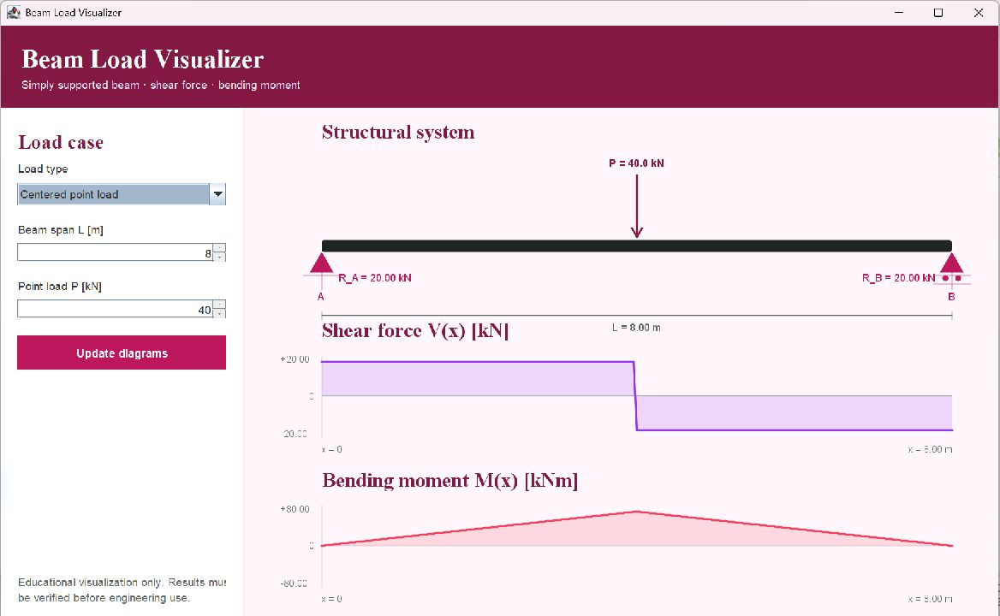

# Beam Load Visualizer

An interactive Java application for visualizing a simply supported beam under
either a centered point load or a linearly increasing triangular distributed
load. The application draws the structural system together with its shear
force and bending moment diagrams.

This project is a dependency-free redevelopment of a university exercise in
structural mechanics. It connects civil-engineering fundamentals with a small,
clear desktop application.



## Features

- Centered point load
- Triangular distributed load increasing from left to right
- Support reactions
- Shear force diagram
- Bending moment diagram
- Adjustable span and load magnitude
- SI units and input validation
- No external libraries

## Structural model

The beam is simply supported at both ends.

### Centered point load

For a point load `P` at `x = L / 2`:

- `R_A = R_B = P / 2`
- `V(x) = P / 2` for `0 <= x < L / 2`
- `V(x) = -P / 2` for `L / 2 < x <= L`
- `M(x) = (P / 2) x` on the left half
- `M(x) = (P / 2) (L - x)` on the right half

### Triangular distributed load

For `w(x) = w_max x / L`:

- `R_A = w_max L / 6`
- `R_B = w_max L / 3`
- `V(x) = R_A - w_max x^2 / (2L)`
- `M(x) = R_A x - w_max x^3 / (6L)`

## Requirements

- JDK 17 or newer

## Run locally

From the project directory:

```text
javac -d out src/main/java/dev/sarasaido/beamvisualizer/BeamVisualizer.java
java -cp out dev.sarasaido.beamvisualizer.BeamVisualizer
```

## Project structure

```text
beam-load-visualizer/
├── src/main/java/dev/sarasaido/beamvisualizer/BeamVisualizer.java
├── .gitignore
├── LICENSE
└── README.md
```

## Engineering note

This application is intended for learning and visualization. It is not a
substitute for verified structural-analysis software or a design calculation.

## Author

Sara Saido — Civil Engineering, BIM, Java, Python, and applied AI


